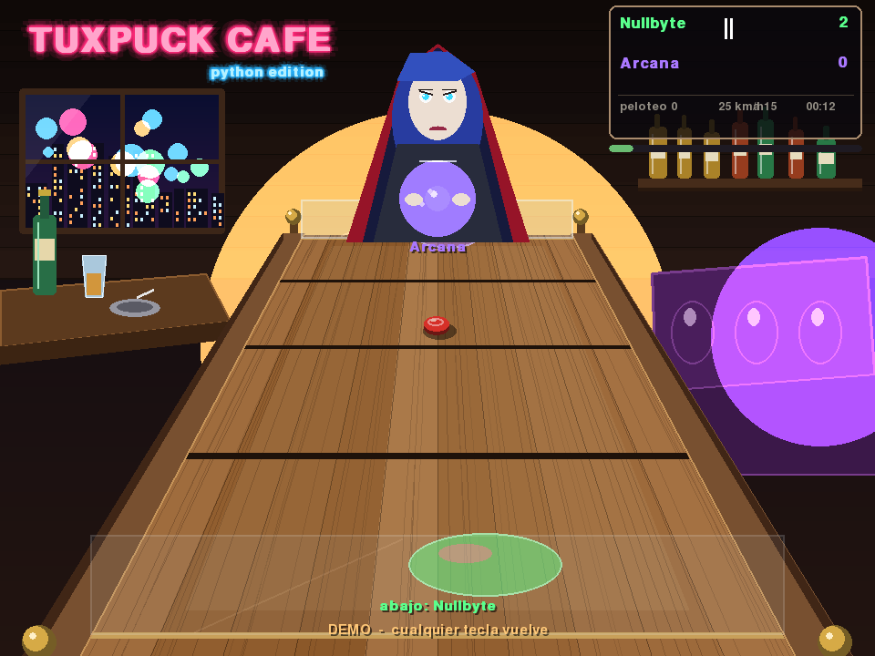
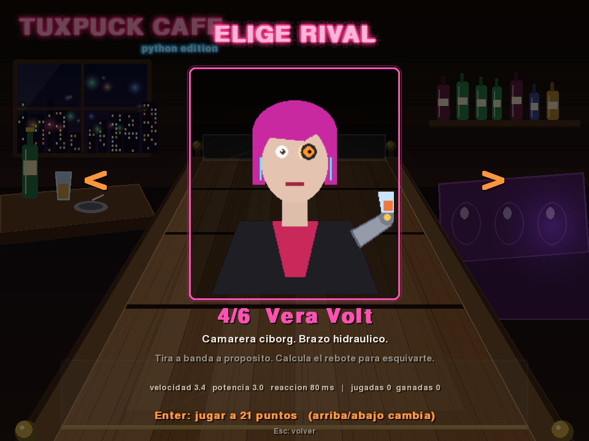
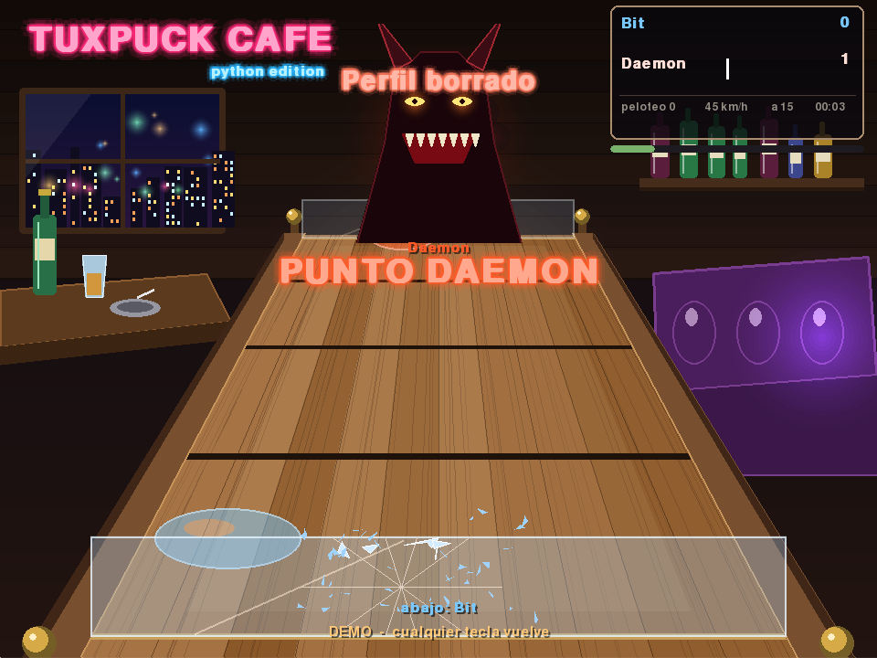

# TuxPuck Python 🐧🏒

**Un remake en un solo fichero (`tuxpuckpython.py`) del clásico TuxPuck, el clon libre de *Shufflepuck Café*, reescrito desde cero en Python 3 (2026) y vitaminado hasta donde cabe sin romper el espíritu del original.**

```bash
pip install pygame-ce        # única dependencia (numpy es opcional, acelera el sintetizador de audio)
python tuxpuckpython.py      # y a jugar
```

Sin assets externos: tablero, personajes, cristal, marcador, sonidos y música se generan por código al arrancar. Un fichero, cero carpetas, cero descargas.



|  |  |
|---|---|

---

## Índice

1. [Qué era TuxPuck (y por qué merece un remake)](#1-qué-era-tuxpuck-y-por-qué-merece-un-remake)
2. [Lo que se ha leído del código C antes de escribir una línea](#2-lo-que-se-ha-leído-del-código-c-antes-de-escribir-una-línea)
3. [Qué es TuxPuck Python: la vitamina](#3-qué-es-tuxpuck-python-la-vitamina)
4. [Instalación y ejecución](#4-instalación-y-ejecución)
5. [Controles](#5-controles)
6. [Modos de juego](#6-modos-de-juego)
7. [Los oponentes](#7-los-oponentes)
8. [Mutadores y ajustes](#8-mutadores-y-ajustes)
9. [Física: fidelidad al original y extensiones](#9-física-fidelidad-al-original-y-extensiones)
10. [Inteligencia artificial](#10-inteligencia-artificial)
11. [Gráficos procedurales](#11-gráficos-procedurales)
12. [Audio procedural](#12-audio-procedural)
13. [Persistencia, estadísticas y perfil](#13-persistencia-estadísticas-y-perfil)
14. [Línea de comandos](#14-línea-de-comandos)
15. [Arquitectura del fichero](#15-arquitectura-del-fichero)
16. [Pruebas](#16-pruebas)
17. [Hoja de ruta](#17-hoja-de-ruta)
18. [Créditos y licencia](#18-créditos-y-licencia)

---

## 1. Qué era TuxPuck (y por qué merece un remake)

En 1988 Brøderbund publicó *Shufflepuck Café* para Amiga, Atari ST y Macintosh: un bar de mala muerte en una estación espacial, una mesa de air hockey en falsa 3D y una galería de oponentes cada vez más tramposos. Era simple, inmediato, y tenía algo que casi ningún juego de deporte ha vuelto a tener: **personajes con mala leche**.

Entre 2001 y 2002 Jacob "noork" Kroon escribió **TuxPuck** en C con SDL 1.2, con gráficos de m0ns00n (Hogne Titlestad): un homenaje libre en el que el jugador se enfrenta a Tux y a Arcana, una hechicera que sirve el disco haciéndolo girar en espiral. La versión **0.8.2** salió en 2002 y ahí se quedó. Debian la sigue empaquetando veinte años después (`tuxpuck_0.8.2-12`) a base de parches de compatibilidad: libpng16, libjpeg-turbo, SDL 1.2 emulado sobre SDL2. Es un fósil que todavía respira.

Lo que justifica el remake:

- **El diseño es bueno.** Perspectiva fija, un disco, dos palas, 15 puntos. Nada que quitar.
- **El código es viejo.** SDL 1.2, blits con *dirty rects*, punteros a función para la IA. Compilarlo hoy exige pelearse con el toolchain.
- **Se quedó corto.** El propio `todo.txt` del autor pedía "IA más sofisticada". Nunca llegó.
- **Un fichero Python es el formato más portable que existe en 2026.** Se lee, se modifica, se comparte.

## 2. Lo que se ha leído del código C antes de escribir una línea

Las fuentes vivas están en el repositorio Debian (`https://salsa.debian.org/games-team/tuxpuck.git`) y en el espejo GitHub `emna01/tuxpuck`. Son 3.689 líneas de C en 18 ficheros. Esto es lo que importa de ellas y que el remake reproduce con exactitud:

### 2.1 Sistema de coordenadas del tablero

| Magnitud | Valor original | Comentario |
|---|---|---|
| Ancho jugable | `x ∈ [-20, 20]` | unidades de tablero, no píxeles |
| Largo jugable | `z ∈ [-42, 42]` | el humano está en `z < 0`, el rival en `z > 0` |
| Disco (`PUCK_W`) | `2.8` | diámetro |
| Pala (`PAD_W` × `PAD_H`) | `9.4 × 0.02` | la pala es prácticamente una línea |
| Zona de la pala humana | `z ∈ [-40, -20.8]` | nunca cruza el centro |
| Zona de la pala rival | `z ∈ [20.8, 40]` | |
| Gol | `z > 40` (punto humano) / `z < -40` (punto rival) | el disco atraviesa un cristal que estalla |
| Puntos para ganar | `15` | |

### 2.2 Proyección pseudo-3D

Pantalla 640×480. El tablero ocupa de `y=175` (fondo) a `y=465` (frente) y de `x=203` a `x=517` en el borde lejano. La proyección es una homografía 1D sobre `z`:

```
y(z)      = c0 / (c1 + z)      c0 = 80·(465·175)/(465-175)   c1 = 40·(465+175)/(465-175)
scale(z)  = c2 / (c3 + z)      c2 = 80·(203/517)/(1-203/517) c3 = 40·(1+203/517)/(1-203/517)
x_pantalla = 320 + scale(z) · x · 12.7
```

`scale(-40) = 1.0` y `scale(40) ≈ 0.39`: un sprite en el fondo mide el 39 % de lo que mide delante. El remake usa **exactamente** esta proyección (escalada ×1.5 a un lienzo lógico de 960×720) para que el tablero dibujado por código coincida al píxel con el área de colisión.

### 2.3 Física del golpe (`entity.c`)

```
MAX_PUCK_SPEED = 0.20  unidades/ms
HIT_FRICTION   = 0.60
THRESHOLD      = 0.02

al golpear:
  puck.dx = (puck.dx + pad.dx·0.6) · 0.6
  si el disco venía hacia la pala: puck.dz = -puck.dz
  puck.z  = cara de la pala ± (PUCK_W/2 + PAD_H/2 + THRESHOLD)
  puck.dz = (puck.dz + pad.dz·0.6) · 0.6
  si |v| > 0.20: normalizar a 0.20
```

Es decir: el disco **no** rebota elásticamente. Pierde el 40 % en cada golpe y gana el 60 % de la velocidad de la pala. Por eso un disco muerto se "empuja" y un disco rápido se "amortigua". Esa sensación es el corazón del juego y se conserva intacta.

La detección es predictiva: compara la posición del disco y de la pala **en el siguiente paso**, y solo si la cara de la pala va a cruzar el borde del disco y las `x` se solapan (`|Δx| ≤ PAD_W/2 + PUCK_W/2`) se produce el golpe.

### 2.4 Ratón

Velocidad relativa (`SDL_GetRelativeMouseState`), con cursor capturado. Diez niveles: `speed = 0.05 + 0.45·n/10` unidades por píxel. F5/F6 los cambian y una barra azul en el marcador lo muestra durante dos segundos.

### 2.5 La IA (`player.c`, `tux.c`, `arcana.c`)

Una máquina de estados con cinco estrategias intercambiables por puntero a función: `idle`, `serve`, `backup`, `aim`, `hit`.

- **`idle`** (versión *dumb*): la pala persigue la `x` del disco con un ligero vaivén sinusoidal (`sin(t/2)·0.03`) y vuelve a `z=35`. La versión *smart* **predice la `x` de llegada del disco contando rebotes en las bandas** (`_calc_puck_x`, módulo sobre el ancho del tablero). Cuando el disco cruza `z=20`, pasa a `backup`.
- **`backup`**: retrocede a `z=38`. La versión *smart* de Arcana, si el disco va rápido lateralmente (`|dx| > 0.15`), se coloca ya en la `x` prevista.
- **`aim`**: calcula el vector pala→disco y lanza la pala con `hit_power·0.1`. Si el disco está demasiado cerca (`dz > -0.4`), vuelve a `backup`.
- **`hit`**: avanza hasta `z < 21` y vuelve a `idle`.
- **Saque de Arcana** (50 % de las veces): el disco flota hasta `z=0`, da cinco vueltas en espiral de radio 10 acelerando, y sale disparado hacia una de dos esquinas a `0.5 u/ms` (¡2,5 veces la velocidad máxima normal!).

| Rival | `speed` | `hit_power` | `idle` | `backup` |
|---|---|---|---|---|
| Tux | 3.0 | 2.5 | smart | dumb |
| Arcana | 2.5 | 2.5 | dumb | smart |

Tux tiene una animación de ojos (`eyes.ac`, sprite de 2 fotogramas) y dos sonidos (aplauso, abucheo); Arcana no reacciona. Eso es **todo** el contenido del original. Ahora, la vitamina.

## 3. Qué es TuxPuck Python: la vitamina

Un remake es un contrato: se conserva lo que funciona y se mejora lo que el autor no tuvo tiempo de hacer. Lo conservado está en la sección 2. Lo añadido:

| Área | Original (2002) | TuxPuck Python (2026) |
|---|---|---|
| Fichero | 18 `.c` + 20 assets + Makefile | **1 `.py`**, 0 assets |
| Dependencias | SDL 1.2, libpng, libjpeg, libvorbis, freetype | `pygame-ce` (numpy opcional) |
| Resolución | 640×480 fija | lienzo lógico 960×720 escalado a cualquier ventana, pantalla completa con letterbox |
| Bucle | paso variable (`SDL_Delay(10)`) | **física a paso fijo (4 ms)** + render a la frecuencia del monitor, determinista con semilla |
| Rivales | 2 | **6**, en escalera de dificultad, cada uno con personalidad, retrato animado, frases y estilo de saque |
| IA | 2 combinaciones de 5 estrategias | las mismas + tiempo de reacción, error de puntería, predicción de rebotes, **tiros a banda**, **amagos**, adaptación al marcador |
| Modos | partida | **Partida rápida, Torneo, Versus local, Práctica, Demo (IA vs IA)** |
| Control | ratón | ratón, **teclado**, **mando** (stick izquierdo); dos jugadores en la misma máquina |
| Mutadores | — | velocidad del disco, **hasta 3 discos**, tamaño de pala, niebla, **efecto (spin) arcade**, puntos a 7/11/15/21 |
| Gráficos | JPG/PNG prerenderizados | tablero, bar, neón, retratos, cristal, sombras, estela, partículas: **todo procedural** |
| Efectos | 5 trozos de cristal | 5 trozos grandes + lluvia de esquirlas, flash, **temblor de cámara**, estela del disco, brillo por velocidad |
| Audio | 4 `.ogg` | **sintetizador propio**: golpes, banda, cristal, abucheos, vítores, menú, fanfarrias y **música ambiente generada** por un secuenciador |
| HUD | marcador de palotes | marcador de palotes (homenaje), nombres, **contador de peloteo**, velocímetro del disco, barra de ratón, cronómetro |
| Persistencia | `~/.tuxpuckrc` (3 claves) | JSON con ajustes, **estadísticas por rival**, rachas, récords (peloteo, tiro más rápido), progreso del torneo |
| Accesibilidad | — | pausa real, menús con ratón y teclado, paleta legible, ayuda en juego (F1), opción de ventana sin captura de ratón |
| Pruebas | ninguna | `--selftest` (física, colisiones, IA, persistencia) y `--autoplay` headless para CI |

Todo esto cabe en un fichero porque la complejidad está donde debe: en el diseño, no en el *tooling*.

## 4. Instalación y ejecución

Requisitos: **Python 3.11 o superior** (probado con 3.13) y `pygame-ce` 2.5+.

```bash
python -m venv .venv && source .venv/bin/activate     # Windows: .venv\Scripts\activate
pip install -r requirements.txt                       # pygame-ce (+ numpy opcional)
python tuxpuckpython.py
```

Alternativas:

```bash
pipx run --spec pygame-ce python tuxpuckpython.py     # sin tocar el sistema
python tuxpuckpython.py --fullscreen                  # a pantalla completa desde el arranque
python tuxpuckpython.py --opponent daemon --points 7  # directo al jefe final, a 7 puntos
```

En Linux, si `pygame-ce` no encuentra `libSDL2`, instale `libsdl2-2.0-0` (Debian/Ubuntu) o `SDL2` (Fedora/Arch). En Wayland el juego captura el ratón mediante el modo relativo de SDL2; si su compositor no lo soporta, use el control por teclado o la opción `Captura de ratón: no` en Ajustes.

## 5. Controles

### En partida

| Acción | Ratón | Teclado (J1) | Teclado (J2, versus) | Mando |
|---|---|---|---|---|
| Mover la pala | mover el ratón | `W A S D` | `↑ ← ↓ →` | stick izquierdo |
| Golpe fuerte (empujón breve) | botón izquierdo | `Espacio` | `Enter` del teclado numérico | `A` / `✕` |
| Pausa / menú | `Esc` | `Esc` | `Esc` | `Start` |

### Teclas globales

| Tecla | Efecto |
|---|---|
| `F` | pantalla completa / ventana |
| `F1` | ayuda rápida (en el original `F1` alternaba el sonido; aquí eso es `M`) |
| `M` | silenciar / activar sonido |
| `F5` / `F6` | velocidad del ratón − / + (1 a 10) |
| `F3` | FPS y datos de depuración |
| `F12` | captura de pantalla (`tuxpuck-AAAAMMDD-HHMMSS.png` en el directorio actual) |
| `Esc` | en menús: atrás |

El "golpe fuerte" es una adición: durante 120 ms la pala multiplica por 1,6 su velocidad hacia delante. Sirve para rematar discos muertos sin tener que hacer un gesto brusco con el ratón. Se puede desactivar en Ajustes para jugar en modo purista.

## 6. Modos de juego

- **Partida rápida.** Elija rival y puntos. Las estadísticas cuentan.
- **Torneo.** La escalera de *Shufflepuck Café*: los seis rivales en orden. Se guarda el progreso; perder una final no borra lo conquistado. Completar la escalera desbloquea el modo **Pesadilla** (todos los rivales con reacción y potencia al máximo).
- **Versus local.** Dos humanos en la misma máquina: J1 con ratón o `WASD`, J2 con flechas o mando. La cámara es la misma para ambos (el J2 juega "desde arriba", como el rival): es raro treinta segundos y luego es la mejor forma de entender cómo ve el juego la IA.
- **Práctica.** Sin marcador ni fin. Se dibuja la **trayectoria prevista del disco** con sus rebotes, exactamente la misma que calcula la IA *smart*. Ideal para aprender a tirar a banda.
- **Demo.** IA contra IA, modo *attract*. Se activa sola tras 40 segundos en el título y con `--autoplay` desde la terminal.

## 7. Los oponentes

Cada rival es una ficha de datos (`OpponentSpec`): nombre, lema, paleta, función de retrato, parámetros de IA y frases. Añadir un séptimo es añadir una ficha.

| # | Nombre | Quién es | Velocidad | Potencia | Reacción | Error | Rasgo |
|---|---|---|---|---|---|---|---|
| 1 | **Bit** | Robot de limpieza del bar al que nadie pidió opinión | 1.8 | 1.6 | 260 ms | alto | Persigue el disco sin predecir. Se despista con los rebotes. El tutorial con patas. |
| 2 | **Tux** | El pingüino. Parámetros exactos del original | 3.0 | 2.5 | 120 ms | medio | *smart idle* + *dumb backup*: predice bien, remata regular. Aplaude y abuchea. |
| 3 | **Arcana** | La hechicera. Parámetros exactos del original | 2.5 | 2.5 | 100 ms | medio | Saque en espiral al 50 %. *Smart backup*: se coloca antes de que llegues. |
| 4 | **Vera Volt** | Camarera ciborg, brazo hidráulico | 3.4 | 3.0 | 80 ms | bajo | **Tira a banda** a propósito un 40 % de las veces: calcula el rebote para esquivarte. |
| 5 | **Nullbyte** | Un error de segmentación con cara | 3.8 | 3.2 | 50 ms | bajo | **Amaga**: se lanza, frena, y golpea en el segundo impulso. Su retrato parpadea con *glitches*. |
| 6 | **Daemon** | Lo que vive en `/dev/null` | 4.2 | 3.6 | 30 ms | mínimo | Predicción perfecta, bandas y amagos. Único punto débil: su pala, como todas, pierde el 40 % en cada golpe. Los tiros blandos en diagonal lo descolocan. |

Los retratos son dibujos vectoriales (`pygame.draw` y polígonos): los **ojos siguen al disco**, la boca cambia con el estado de ánimo, y cada personaje tiene una animación de victoria y otra de derrota. Las frases se eligen al azar entre tres por situación y se muestran como bocadillo sobre el retrato.

## 8. Mutadores y ajustes

Menú **Arcade** (se aplican a Partida rápida y Versus; el Torneo siempre es limpio):

| Mutador | Valores | Efecto |
|---|---|---|
| Velocidad del disco | 0.6× · 0.8× · 1× · 1.25× · 1.5× | multiplica `MAX_PUCK_SPEED` y la potencia de todos |
| Discos | 1 · 2 · 3 | cada disco puntúa por separado; con tres, el caos |
| Pala | 0.6× · 1× · 1.4× | anchura; a 0.6× el Daemon se vuelve humano |
| Niebla | no · sí | la mitad lejana del tablero se oscurece: hay que leer el disco por el sonido |
| Física | Clásica · Arcade | Arcade añade **efecto**: la velocidad lateral de la pala imprime giro y el disco curva (ver §9) |
| Puntos | 7 · 11 · 15 · 21 | |

Menú **Ajustes**: resolución de ventana, pantalla completa, volumen de efectos, volumen de música, velocidad de ratón, captura de ratón, golpe fuerte, mostrar FPS, nombre del jugador, borrar perfil.

## 9. Física: fidelidad al original y extensiones

### 9.1 Paso fijo

El original integraba con el tiempo real entre frames (típicamente 10 ms). Eso hace el juego dependiente de la máquina: en un portátil lento el disco atraviesa palas. El remake integra a **4 ms fijos** con acumulador; el render interpola entre el estado anterior y el actual. Con la misma semilla (`--seed`) una partida IA vs IA es reproducible bit a bit, que es lo que permite probarla en CI.

### 9.2 Colisión continua pala-disco

Se mantiene el test predictivo original (§2.3), que funciona porque la pala es una línea y el disco un círculo que se mueve a lo sumo 0,8 unidades por paso (0,2 u/ms × 4 ms), menos que `PUCK_W`. Con mutador de velocidad 1,5× se mantiene por debajo de `PUCK_W/2`, de modo que no hay túneles.

### 9.3 Bandas

Rebote especular en `x = ±(20 - PUCK_W/2)` con el sonido de "nock" del original. Las bandas en `z = ±42` también rebotan (el disco no sale del tablero), pero antes de llegar ahí ya ha cruzado la línea de gol en `|z| = 40`.

### 9.4 Efecto (solo física Arcade)

Al golpear, `spin = clamp((pad.dx − puck.dx) · 5, −1, 1)`. En cada paso `puck.dx += spin · |puck.dz| · 0.0013 · dt`, con decaimiento `spin ·= 0.998^dt` y rebote de banda que invierte y halva el efecto. El resultado es una curva de unas 5 unidades a lo largo del tablero: suave, visible, y recompensa el golpe cruzado. Cuando hay efecto, la IA con predicción integra la trayectoria numéricamente (`predict_path`) en lugar de usar el módulo analítico.

### 9.5 Múltiples discos

El tablero mantiene una lista de discos. Cada uno tiene su propia máquina de estados (vivo, muerto, cristal). Cuando uno marca, solo ese se repone; los demás siguen. La IA ataca al disco más cercano a su lado que se mueva hacia ella, o al más cercano a secas.

## 10. Inteligencia artificial

La máquina de estados original se conserva (`IDLE → BACKUP → AIM → HIT → IDLE`, más `SERVE`, `WIN_POINT`, `LOSE_POINT`). Sobre ella, cada rival ajusta:

- **`reaction_ms`**: la IA no ve el estado actual del disco sino el de hace `reaction_ms`. Es el mecanismo más honesto para graduar dificultad: no se le "quita precisión", se le quita tiempo.
- **`aim_error`**: ruido gaussiano, en unidades de tablero, sobre la `x` objetivo. Se recalcula una vez por punto, no por paso, para que el error sea un *sesgo* (fallo creíble) y no un temblor.
- **`predict_bounces`**: si es verdadero usa `_calc_puck_x` (módulo analítico, rebotes ilimitados); si no, extrapola en línea recta y los rebotes le engañan.
- **`bank_shot`**: probabilidad de que en `AIM`, en vez de apuntar a la portería, apunte a un punto de la banda calculado para que el disco llegue a la esquina opuesta a donde está la pala humana. La IA usa para ello la misma función de predicción que usa para defender, al revés.
- **`feint`**: probabilidad de amagar. En `AIM` lanza la pala a media potencia, se detiene a 2 unidades del disco (`FEINT_HOLD`, 90 ms) y entonces golpea de verdad. Contra un humano que reacciona al primer movimiento, funciona.
- **Guardas nuevas sobre la máquina original**: la IA no persigue un disco que ya se aleja de ella (con percepción retardada, el original entraría en `BACKUP` tras cada golpe propio) y no "golpea al aire" si el disco ya está lejos cuando llega a `AIM`. Sin estas dos reglas dos IAs con retardo se pasaban el partido bailando.
- **Adaptación**: si el rival va perdiendo por 5 o más, `reaction_ms` baja un 20 % y `aim_error` un 30 %. Si va ganando por 5, al revés. Nunca por debajo del mínimo del rival ni por encima de 2× su valor. Es el "goma elástica" de los juegos de carreras, pero suave y documentado para que nadie se sienta estafado.
- **Saques**: `dumb` (retrocede y golpea), `swirl` (la espiral de Arcana), `bank` (saque directo a banda, Vera y superiores) y `feint`.

La IA **no hace trampas con la física**: su pala está sujeta a los mismos límites de zona y el disco obedece las mismas reglas. Solo ve mejor y reacciona antes.

## 11. Gráficos procedurales

Todo se dibuja con primitivas de `pygame` sobre superficies que se cachean al iniciar la escena:

- **Bar**: degradado oscuro, pared de madera con tablones, una ventana con luces de ciudad hechas de puntos difuminados, un sofá de cuero al fondo (polígonos con brillo), botella y cenicero sobre una mesa a la izquierda, y el rótulo de neón **TUXPUCK CAFÉ** con parpadeo aleatorio (una letra falla de vez en cuando).
- **Mesa**: trapecio con la proyección de §2.2; vetas de madera como líneas de ruido convergentes al punto de fuga; dos barandillas laterales con cuatro bolas de latón; tres líneas transversales como en el original; el cristal de cada portería como un rectángulo translúcido con reflejo diagonal.
- **Disco**: elipse con sombra proyectada y aplastada por la perspectiva; a más velocidad, más larga la estela (últimas 10 posiciones con alfa decreciente) y un halo.
- **Palas**: elipses translúcidas (alfa 128, como el original), color por jugador, borde brillante al golpear.
- **Cristal roto**: las cinco piezas originales (polígonos con gravedad −0.001 u/ms²) más 40 esquirlas pequeñas; flash blanco de 80 ms y temblor de cámara con decaimiento exponencial.
- **Retratos**: 160×180, vectoriales, con dos capas (base cacheada + ojos/boca dibujados cada frame).
- **Tipografía**: la fuente por defecto de pygame con sombra; el neón se consigue con tres pasadas de desenfoque barato (blit con alfa a offsets).

Rendimiento: con el bar y la mesa cacheados, un frame completo de partida (dos discos, niebla, retrato animado, marcador) cuesta unos 4 ms de CPU en un portátil corriente, y la física con dos IAs menos de 0,2 ms. Sobra margen para 60 FPS en cualquier máquina de la última década.

## 12. Audio procedural

Un sintetizador mínimo (`Synth`) genera buffers PCM de 16 bits a 22.050 Hz en el arranque (con numpy en unas decenas de milisegundos; sin numpy, con `array` puro, en medio segundo):

| Sonido | Receta |
|---|---|
| Golpe de pala (`nock`) | seno de 180 Hz con envolvente exponencial de 60 ms + ráfaga de ruido de 15 ms |
| Banda (`tick`) | igual, a 420 Hz y 30 ms |
| Cristal (`crash`) | ruido blanco con decaimiento de 600 ms + 6 senos agudos (2 a 6 kHz) desfasados ("tintineo") |
| Disco rápido (`whoosh`) | ruido filtrado con barrido de amplitud, 200 ms |
| Vítores | ruido rosa aproximado con envolvente de ataque lento, 900 ms |
| Abucheo | diente de sierra a 110 Hz con vibrato, 700 ms |
| Menú | seno de 880 Hz, 40 ms |
| Punto | dos notas (660 → 990 Hz) |
| Fanfarria / derrota | arpegio mayor ascendente / cromático descendente |
| Música | secuenciador de 8 compases a 96 BPM: bajo de onda cuadrada, arpegio triangular y charles de ruido, en bucle; se genera una vez por semilla, así cada perfil tiene su propio tema |

Volúmenes independientes de efectos y música; `M` silencia todo.

## 13. Persistencia, estadísticas y perfil

Fichero JSON en el directorio de configuración del usuario:

- Linux: `~/.config/tuxpuckpython/profile.json` (respeta `XDG_CONFIG_HOME`)
- macOS: `~/Library/Application Support/tuxpuckpython/profile.json`
- Windows: `%APPDATA%\tuxpuckpython\profile.json`

Contiene: ajustes, mutadores, nombre del jugador, progreso del torneo, desbloqueos, y estadísticas: partidas, victorias y derrotas por rival, racha actual y mejor racha, **peloteo más largo**, **tiro más rápido** (en unidades/ms y en "km/h de bar", una conversión caprichosa de 1 u/ms = 500 km/h para que el velocímetro luzca), tiempo total jugado. La pantalla **Estadísticas** lo muestra todo; **Borrar perfil** en Ajustes lo reinicia.

El fichero se escribe de forma atómica (temporal + `os.replace`) y, si está corrupto, se ignora y se regenera sin perder la partida en curso.

## 14. Línea de comandos

```
usage: tuxpuckpython.py [-h] [--version] [--fullscreen | --windowed]
                        [--opponent {bit,tux,arcana,vera,nullbyte,daemon}]
                        [--points {7,11,15,21}] [--mute] [--seed N]
                        [--autoplay SECONDS] [--screenshot FILE]
                        [--selftest] [--no-music] [--scale FACTOR]
```

| Opción | Uso |
|---|---|
| `--opponent X --points N` | salta los menús y arranca la partida |
| `--seed N` | semilla del generador aleatorio (reproducibilidad, mismo tema musical) |
| `--autoplay S` | demo IA vs IA durante `S` segundos y salida; con `SDL_VIDEODRIVER=dummy` sirve para CI |
| `--screenshot F` | junto a `--autoplay`, guarda el último frame en `F` |
| `--selftest` | pruebas internas (física, colisiones, predicción, IA, JSON); código de salida 0/1 |
| `--mute`, `--no-music` | arrancar sin sonido / sin música |
| `--scale 1.5` | tamaño de ventana inicial respecto al lienzo lógico |

## 15. Arquitectura del fichero

Un fichero no significa un pegote. `tuxpuckpython.py` está dividido en secciones numeradas con una cabecera de 78 guiones, en este orden, cada una con sus clases:

```
 0. Cabecera, imports, comprobación de dependencias
 1. Constantes del tablero y de la física (los números de §2)
 2. Utilidades: clamp, lerp, color, temporizadores, rutas de configuración
 3. Perspective         — proyección §2.2, inversa para el puntero del menú
 4. Profile             — dataclass de ajustes + estadísticas + JSON atómico
 5. Synth / AudioBank   — sintetizador y catálogo de sonidos; Music (secuenciador)
 6. Art                 — generadores de superficies: bar, mesa, disco, pala, cristal, retratos
 7. Entity / Pad / Puck — el modelo físico; collide() es el port de entity.c
 8. Glass / Shards / FX — cristal, partículas, temblor, flash, estela
 9. Board               — estados PLAY / NEW_PUCK / CRASH_GLASS, lista de discos, árbitro
10. Controllers         — HumanController (ratón, teclado, mando) y AIController (estrategias)
11. OPPONENTS           — las seis fichas OpponentSpec
12. UI                  — texto con sombra/neón, Menu, bocadillos, Scoreboard, HUD, transiciones
13. Scenes              — Title, MainMenu, OpponentSelect, Match, Pause, Result, Tournament,
                          Settings, Arcade, Stats, Help, Credits, Demo
14. App                 — ventana, lienzo lógico, bucle a paso fijo, eventos globales
15. selftest()          — pruebas
16. main()              — argparse y arranque
```

Reglas que se han seguido:

- **Ninguna clase conoce a `pygame.display`** salvo `App`. Todo dibuja sobre la superficie que recibe. Eso es lo que permite el modo headless.
- **El modelo (secciones 7 a 11) no importa nada de la vista (12 a 14).** La IA se prueba sin abrir ventana.
- **Las constantes del original están una sola vez**, con su nombre en C al lado, para que cualquiera pueda auditar la fidelidad.
- **Sin estado global mutable** salvo el `Profile` cargado y el `AudioBank`. Las escenas reciben una referencia a `App` y a partir de ahí todo es explícito.

## 16. Pruebas

```bash
python tuxpuckpython.py --selftest
SDL_VIDEODRIVER=dummy SDL_AUDIODRIVER=dummy python tuxpuckpython.py --autoplay 20 --seed 7 --screenshot demo.png
```

`--selftest` comprueba: proyección (`y(-40)=465·1.5`, `scale(-40)=1`, ida y vuelta de `unproject`), rebote en banda, que un golpe frontal invierte `dz` y aplica la fricción de 0,6, el tope de velocidad, que una pala fuera de alcance no golpea, que `_calc_puck_x` coincide con la simulación paso a paso en 40 trayectorias aleatorias con varios rebotes, que el efecto arcade curva de verdad, el saque, el gol y la alternancia del tablero, un tablero con tres discos y mutadores, que **cada uno de los seis rivales marca 30 puntos contra Bit sin colgarse** (y que Arcana saca en espiral), que Tux contra Tux pelotea 20 s sin excepciones, que el Daemon en Pesadilla barre a Bit, que el perfil sobrevive a un fichero corrupto y a tipos equivocados, que el sintetizador y el secuenciador producen audio, que el teclado acelera la pala, y que el fondo, los seis retratos en sus cinco estados de ánimo, el disco, la pala y el cristal roto se dibujan. Son 37 aserciones y tardan unos seis segundos. `TUXPUCK_NO_NUMPY=1` fuerza el camino sin numpy del sintetizador.

## 17. Hoja de ruta

Lo que no está y podría estar, por orden de valor:

1. **Red** (el otro punto del `todo.txt` original). El modelo a paso fijo y determinista está pensado para *lockstep*: dos clientes, misma semilla, intercambio de entradas por UDP. Es trabajo, pero no es rediseño.
2. **Repeticiones**: grabar las entradas por paso y reproducirlas. Gratis con el paso fijo; faltan la UI y el formato.
3. **Rivales de la comunidad**: cargar fichas `OpponentSpec` desde JSON externo con retratos definidos como listas de polígonos. Rompe la regla de "un fichero" solo si el usuario quiere.
4. **Tablero con obstáculos** (el "Café" de 1988 tenía mesas con barreras en versiones posteriores).

## 18. Créditos y licencia

- **Shufflepuck Café** (1988): Christopher Gross, Brøderbund. La idea.
- **TuxPuck 0.8.2** (2001–2002): Jacob Kroon (código), m0ns00n / Hogne Titlestad (gráficos), Ernst Moritz Hahn (predicción de rebotes), Sven Velt (manpage), Urs Streidl (Tux), "Uriah" y "Gio" (sonidos), SDL_rotozoom y SDL_image (zoom y carga). Mantenimiento Debian: Markus Koschany y el Debian Games Team.
- **TuxPuck Python** (2026): reimplementación desde cero en Python por davidvivo-ia.

**Licencia.** Este repositorio se distribuye bajo la licencia **MIT** (ver `LICENSE`). No contiene ni un byte de los assets originales (imágenes, sonidos ni fuentes), y el código es nuevo. Las constantes de física y la estructura de la máquina de estados de la IA se han tomado del código C de TuxPuck, que es GPL-2, como **referencia de comportamiento**: son números y reglas de juego, no copia de código. Si redistribuye este juego junto con los assets de TuxPuck original, esos assets siguen bajo su licencia GPL-2.

Fuentes consultadas:

- `https://salsa.debian.org/games-team/tuxpuck.git` (fuente viva, parches Debian)
- `https://github.com/emna01/tuxpuck` (espejo del Google Code original)
- `https://packages.debian.org/source/forky/tuxpuck`

*"Anyone remember Shufflepuck Cafe for the Amiga/AtariST? I do."* — manpage de `tuxpuck(6)`, marzo de 2002.
